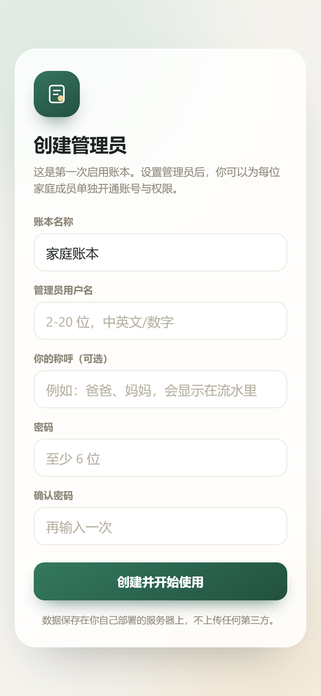
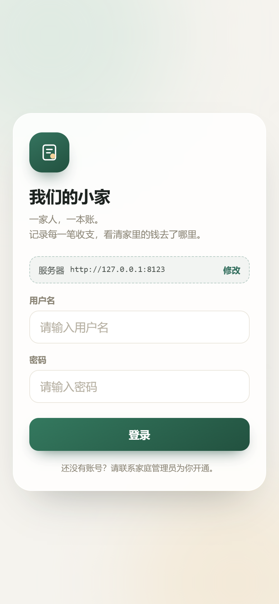
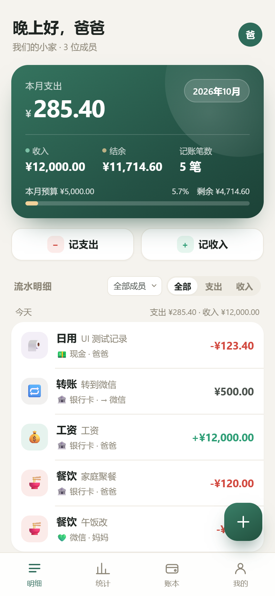
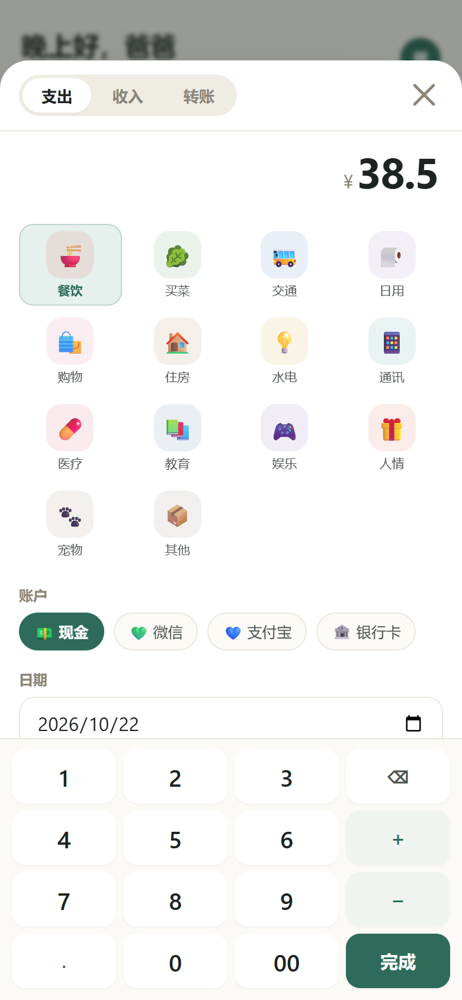
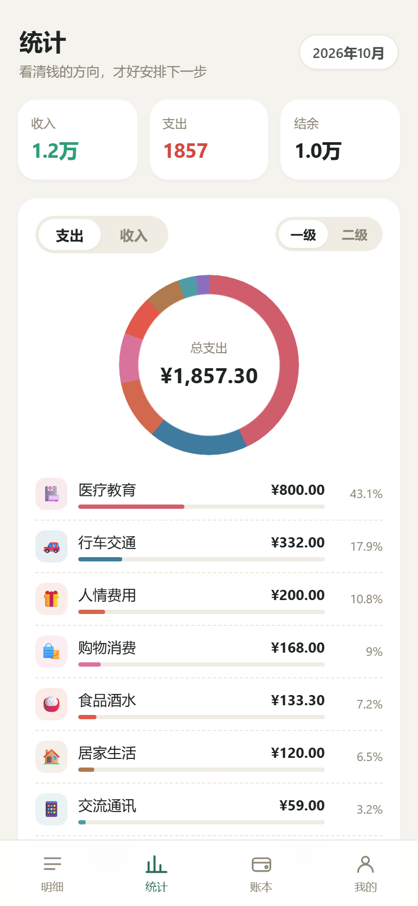
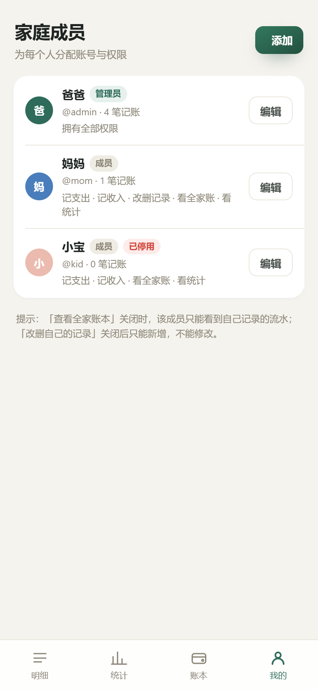
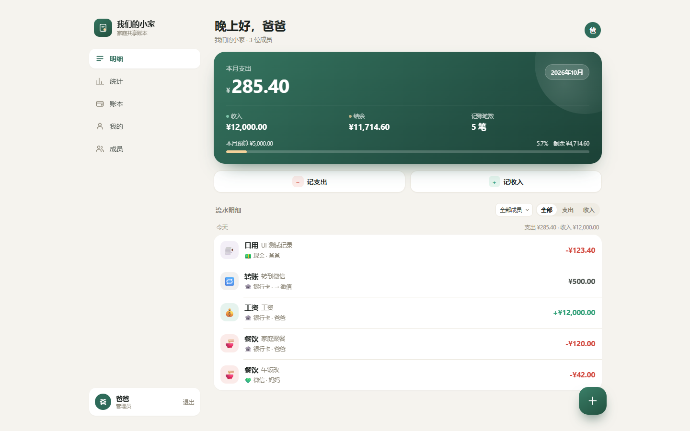
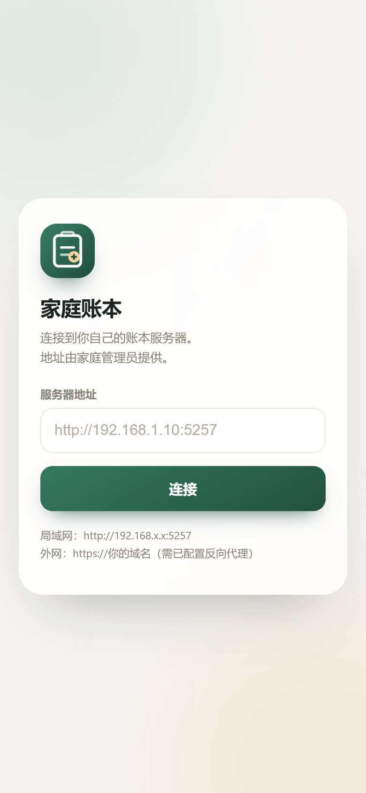

# 家庭账本 · Family Ledger

一家人，一本账。部署在你自己的服务器上，每位家庭成员用手机浏览器登录，各自记录自己的收入与支出，管理员统一管理账号和权限。

- 单容器部署（FastAPI + SQLite + 原生前端），无外部依赖、不访问 CDN、不联外网
- 移动端优先，界面参考主流记账 App（鲨鱼记账、钱迹、MoneyWiz）的账本结构：日历分组流水、分类环形图、月度趋势、预算进度
- 支持 PWA，可「添加到主屏幕」，像 App 一样使用
- 数据只有一份 SQLite 文件，放在 `./data/ledger.db`，备份即拷贝

---

## 一、界面预览

| 初始化 | 登录 | 首页明细 |
| --- | --- | --- |
|  |  |  |

| 记账面板 | 统计 | 成员权限 |
| --- | --- | --- |
|  |  |  |

桌面端（浏览器宽度 ≥ 1000px 时自动切换为侧边栏布局）：



手机 App 首次打开时的连接页（输入服务器地址，之后自动记住）：



---

## 二、快速开始

需要已安装 Docker（Windows / macOS 装 Docker Desktop，NAS 用 Container Manager / Docker）。

```bash
# 进入项目目录
cd 记账软件开发

# 构建并启动（首次构建约 1~2 分钟）
docker compose up -d --build
```

看到 `Container family-ledger Started` 即成功。浏览器打开：

```
http://服务器IP:5257
```

- 本机测试：<http://localhost:5257>
- 手机访问：`http://192.168.x.x:5257`（需与服务器同一局域网）

> 首次打开会自动进入「创建管理员」引导页，设置账本名称、管理员用户名和密码即可。
> 系统只允许初始化一次，之后该页面自动关闭。

常用命令：

```bash
docker compose logs -f      # 查看日志
docker compose restart      # 重启
docker compose down         # 停止（数据保留）
docker compose up -d --build  # 更新代码后重建
```

### 不想用 Docker？直接跑也可以

```bash
pip install -r requirements.txt
python -m uvicorn app.main:app --host 0.0.0.0 --port 5257
```

数据同样落在当前目录的 `data/` 下。需要 Python 3.10+。

---

## 三、外网访问

默认只能在家里局域网访问。要让手机在外面（4G/5G）也能用，有三种方案，按自己的条件挑一个：

| 你的条件 | 推荐方案 | 难度 |
| --- | --- | --- |
| 没有公网 IP，或不想动路由器 | **Cloudflare Tunnel**（出站连接，不开放端口） | ★ |
| 有公网 IP + 自己的域名 | **Caddy 自动 HTTPS** | ★★ |
| 已经有 Nginx 在跑别的服务 | 复用现有 Nginx | ★★ |

> ⚠️ 无论用哪种，**外网一定要走 HTTPS**。直接把 `5257` 端口映射到公网是明文传输，密码会被中间人看到。

### 方案 A：Cloudflare Tunnel（推荐，不用公网 IP）

1. 域名托管到 Cloudflare（免费版足够）
2. 打开 <https://one.dash.cloudflare.com> → **Networks → Tunnels → Create a tunnel**，类型选 **Cloudflared**
3. 复制生成的 token
4. 在项目目录写 `.env`：

```bash
cp .env.example .env
# 编辑 .env，填入：
CLOUDFLARE_TUNNEL_TOKEN=eyJhIjoi...（你的 token）
```

5. 回到 Cloudflare 的隧道页面，**Public Hostname** 添加一条：

```
Subdomain: ledger
Domain:    你的域名
Service:   HTTP → family-ledger:5257
```

6. 启动：

```bash
docker compose -f docker-compose.yml -f deploy/docker-compose.tunnel.yml up -d
```

之后访问 `https://ledger.你的域名`。Cloudflare 会自动签发证书，路由器不用开任何端口。

### 方案 B：Caddy 自动 HTTPS（有公网 IP + 域名）

前提：域名 A 记录指向家里公网 IP，路由器把 **80、443** 端口映射到这台机器。

```bash
cp .env.example .env
# .env 里填 DOMAIN=ledger.你的域名

docker compose -f docker-compose.yml -f deploy/docker-compose.caddy.yml up -d
```

Caddy 会自动申请并续期 Let's Encrypt 证书，配置在 `deploy/Caddyfile`。

### 方案 C：已有 Nginx

把 `deploy/nginx.conf` 里的 server 段贴进你的 Nginx 配置，改掉域名和证书路径即可。关键三行别漏：

```nginx
proxy_set_header Host              $host;
proxy_set_header X-Forwarded-For   $proxy_add_x_forwarded_for;
proxy_set_header X-Forwarded-Proto $scheme;
```

（`X-Forwarded-Proto` 让后端知道请求是 HTTPS，才能正确下发 HSTS。）

### 外网访问时的安全说明

- 应用已内置：登录失败限流（同账号 5 分钟内 8 次失败锁定）、scrypt 密码哈希、HSTS、CSP、`X-Frame-Options` 等安全头
- 请务必给每个家人单独的账号，不要共用管理员
- 管理员密码建议 10 位以上，别用生日/手机号
- 建议每月备份一次 `data/ledger.db`（见「备份与恢复」）
- 如需更强的防护，可在 Cloudflare 侧加 Access 策略（邮箱验证码）或 WAF

---

## 四、手机 App（Android）

两种用法，按需要选：

### 方式一：PWA（不用装包，30 秒搞定）

手机浏览器打开账本地址 →
- iOS Safari：分享 → **添加到主屏幕**
- Android Chrome：菜单 → **添加到主屏幕**

图标、启动方式都像原生 App，内容实时更新，不占额外存储。**日常使用推荐这个。**

### 方式二：APK 安装包（真正的 App，可离线保留入口）

仓库里已经带了完整的 Android 工程（Capacitor 壳），`mobile/` 目录：

- `mobile/www/` —— 连接页（输入服务器地址 → 跳转到你的账本）
- `mobile/android/` —— 原生工程（应用名、图标、启动屏都已换成家庭账本品牌）
- 应用 ID：`com.handzeros.familyledger`

**构建方法 A：GitHub Actions（不需要本地装 Android 环境）**

代码推到 GitHub 后：
1. 打开仓库 **Actions → Build Android APK → Run workflow**
2. 跑完在页面的 **Artifacts** 里下载 `family-ledger-debug-apk`
3. 手机上安装 `app-debug.apk`（需允许「安装未知来源应用」）

打 tag 会自动发 Release：

```bash
git tag v1.0.0
git push origin v1.0.0
```

**构建方法 B：本地 Android Studio**

用 Android Studio 打开 `mobile/android` 目录，等 Gradle 同步完成后：
- 菜单 **Build → Build Bundle(s)/APK(s) → Build APK(s)**
- 或命令行：`cd mobile/android && ./gradlew assembleDebug`
- 产物：`mobile/android/app/build/outputs/apk/debug/app-debug.apk`

改了连接页（`mobile/www`）后要同步一次：

```bash
cd mobile && npx cap sync android
```

**说明**

- 这是「WebView 壳」型 App：界面仍从你的服务器加载，所以**升级服务端不用重新发版**，App 只负责提供图标入口和服务器地址
- 首次打开输入服务器地址（如 `http://192.168.1.10:5257` 或 `https://ledger.你的域名`），地址会记住
- 局域网地址是 HTTP，工程里已开启 `usesCleartextTraffic`，可以正常连接
- debug 包可直接安装使用；如果要上架应用商店，需要用正式 keystore 签名（`./gradlew assembleRelease`）

---

## 五、使用流程

### 1. 管理员：为家人开通账号

进入「我的 → 家庭成员管理 → 添加」，填写：

| 项目 | 说明 |
| --- | --- |
| 显示名称 | 流水里显示的名字，如「妈妈」 |
| 登录用户名 | 家人登录用，2~20 位中英文/数字 |
| 初始密码 | 至少 6 位，可让家人登录后自行修改 |
| 角色 | 家庭成员 / 管理员（管理员拥有全部权限） |
| 权限 | 按下表勾选 |

### 2. 权限说明

| 权限 | 作用 |
| --- | --- |
| 记支出 | 可以记录支出、转账 |
| 记收入 | 可以记录收入 |
| 改删自己的记录 | 关闭后只能新增，不能修改或删除 |
| 查看全家账本 | 关闭则只能看到自己记的流水（适合给孩子用） |
| 查看统计报表 | 可以进入「统计」页看分类占比与趋势 |
| 管理账户 / 分类 / 预算 | 可以增删账户、分类，设置月度预算 |

默认只勾选前两项 + 改删自己的记录，即「只能记自己的账」。

### 3. 记账

- 首页右下角 `＋` 或「记支出 / 记收入」按钮打开记账面板
- 内置数字键盘支持 `+` `-` 连续计算（如买菜 12.5 + 8.3）
- 每笔可指定：分类、账户、日期、备注
- 点任意一条流水即可修改或删除
- 「转账」用于账户之间挪钱（如银行卡 → 微信），不计入收支

### 4. 统计与预算

- 统计页：月度收支汇总、支出/收入分类环形图、近 6 月趋势、每日支出、成员支出排行
- 账本页：设置当月预算，首页会显示预算使用进度

---

## 六、目录结构

```
.
├── Dockerfile                    # 镜像构建
├── docker-compose.yml            # 一键启动（5257 端口）
├── requirements.txt              # 仅 fastapi + uvicorn
├── .env.example                  # 外网访问用到的环境变量
├── app/
│   ├── main.py                   # 所有 API 路由 + 安全响应头
│   ├── auth.py                   # scrypt 密码哈希 + HMAC 令牌 + 权限依赖
│   ├── db.py                     # 建表、种子数据（默认分类/账户）
│   ├── reset_password.py         # 忘记密码时重置
│   └── static/                   # 前端（HTML/CSS/JS，全部本地化）
│       ├── index.html
│       ├── app.css
│       ├── app.js
│       ├── icon.svg              # 矢量图标
│       ├── icons/                # PWA PNG 图标（192/512/maskable/apple）
│       ├── manifest.webmanifest
│       └── sw.js                 # Service Worker（离线壳缓存）
├── deploy/                       # 外网访问
│   ├── docker-compose.caddy.yml  # 方案 A：Caddy 自动 HTTPS
│   ├── docker-compose.tunnel.yml # 方案 B：Cloudflare Tunnel
│   ├── Caddyfile
│   └── nginx.conf                # 方案 C：已有 Nginx
├── mobile/                       # Android App（Capacitor）
│   ├── www/index.html            # 连接页：输入服务器地址
│   ├── capacitor.config.json
│   ├── package.json
│   └── android/                  # 原生工程（图标/启动屏已品牌化）
├── tools/gen-assets.js           # 重新生成图标与启动图
├── .github/workflows/android.yml # 自动构建 APK
├── screenshots/                  # 界面预览图
└── data/                         # 运行后生成，SQLite 数据库所在
```

数据卷映射：宿主机 `./data` → 容器 `/data`。

---

## 七、备份与恢复

```bash
# 备份（连同 -wal/-shm 一起拷贝）
docker compose stop
cp -r data data-backup-20261022
docker compose start

# 恢复
docker compose stop
rm -rf data && cp -r data-backup-20261022 data
docker compose start
```

也可以在「账本 → 导出账单（CSV）」按月导出，Excel 可直接打开。

---

## 八、配置

改 `docker-compose.yml`：

```yaml
ports:
  - "8080:5257"     # 宿主机 5257 被占用时，改成 8080 访问
environment:
  - TZ=Asia/Shanghai # 时区，影响「今天」的判定
```

修改后执行 `docker compose up -d` 生效。

---

## 九、常见问题

**打不开页面？**
1. `docker compose ps` 看容器是否 Up
2. `docker compose logs --tail 50` 看有没有报错
3. 确认访问的 IP 是服务器的局域网 IP，手机与服务器在同一 Wi-Fi
4. 若服务器开了防火墙，放行 5257 端口

**忘记管理员密码？**

```bash
docker compose exec family-ledger python -m app.reset_password admin 新密码
```

**想清空所有数据重新开始？**

```bash
docker compose down
rm -rf data
docker compose up -d
```

**能不能暴露到公网？**

不建议直接暴露端口。如需外网访问，用反向代理（Nginx / Caddy / 群晖反代）加 HTTPS，并保持容器只监听内网。系统已内置登录失败限流（同账号 5 分钟内 8 次失败后锁定），但没有做验证码与二次验证。

**手机怎么像 App 一样用？**

iOS Safari：分享 → 添加到主屏幕；Android Chrome：菜单 → 添加到主屏幕。
（Service Worker 仅在 HTTPS 或 localhost 下注册，HTTP 局域网访问时不影响正常使用。）

---

## 十、技术说明

- **后端**：FastAPI + Uvicorn，SQLite（WAL 模式），每请求独立连接
- **认证**：`scrypt` 密码哈希（标准库），HMAC-SHA256 签名的自包含令牌，30 天有效期；改密码后旧令牌（token_version）立即失效
- **金额**：数据库以「分」为整数存储，避免浮点误差
- **前端**：原生 JS 单页应用，零构建、零 CDN，图表用 CSS `conic-gradient` 与 flex 柱状图绘制
- **权限**：服务端逐接口校验，前端仅做界面隐藏；越权请求返回 403

接口文档（运行中可访问）：`http://服务器IP:5257/api/docs`

---

## 附：发布到 GitHub

仓库已经初始化好（分支 `main`，含首次提交），只差推到远端。

**方式一：用脚本（推荐）**

```bash
bash scripts/publish-github.sh
```

按提示粘贴一次 PAT，脚本会自动创建仓库、推送并配好 `origin`。token 只在本次 `git push` 中使用，不会写进 `.git/config`。

**方式二：手动**

1. 打开 <https://github.com/new>，仓库名填 `family-ledger`，**不要**勾选 README / .gitignore（保持空仓库）
2. 然后执行：

```bash
git remote add origin https://github.com/HandZeros/family-ledger.git
git push -u origin main
```

> GitHub 从 2021 年起就不支持用账号密码推送了，必须用 PAT（个人访问令牌）。
> 生成地址：<https://github.com/settings/tokens> —— 经典 token 勾选 `repo` 即可。

推上去之后：
- **Actions → Build Android APK** 可手动触发构建，产物在 Artifacts 里
- 打 tag 会自动创建 Release 并附上 APK：`git tag v1.0.0 && git push origin v1.0.0`
